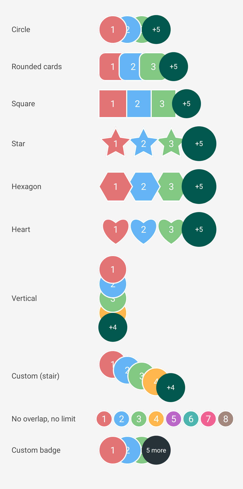

[](https://jitpack.io/#Muzafferus/ImageList-Lib)
[](https://github.com/Muzafferus/ImageList-Lib/actions/workflows/ci.yml)

ImageList-Lib
=============

Overlapping avatar / image / card lists with a "+N" overflow badge for Android.
Works from **Jetpack Compose** and from classic **XML layouts** (including `RecyclerView`).



*The preview above is rendered by the library's own test suite (`ScreenshotTest`) with solid-colour tiles.*

* Any shape: circle, rounded square, square, star, hexagon, heart, or your own Compose `Shape`
* Any content: your own composable for every item and for the badge
* Pluggable overlap logic (half, fixed dp, vertical, gap, or fully custom positions)
* RTL aware, accessible, no fixed image loader requirement in the slot API
* minSdk 21

Installation
------------

```kotlin
// settings.gradle.kts
dependencyResolutionManagement {
    repositories {
        google()
        mavenCentral()
        maven("https://jitpack.io")
    }
}

// module build.gradle.kts
dependencies {
    implementation("com.github.Muzafferus:ImageList-Lib:2.0.0")
}
```

Usage in Jetpack Compose
------------------------

**Avatars from URLs** (loaded with [Coil](https://coil-kt.github.io/coil/)), any `Shape`:

```kotlin
UrlImageList(
    urls = urls,
    maxVisible = 3,                       // the rest is folded into "+N"
    itemSize = 50.dp,
    shape = CircleShape,                  // RoundedCornerShape(12.dp), StarShape(), HeartShape(), ...
    border = BorderStroke(2.dp, Color.White),
    overlap = Overlap.fraction(0.5f),
    placeholder = ColorPainter(Color.LightGray),
)
```

**Your own UI for every item** (the slot is an `itemSize` square, just fill it):

```kotlin
ImageList(
    items = users,
    maxVisible = 4,
    itemSize = 56.dp,
    overlap = Overlap.fixed(12.dp),
    zOrder = ZOrder.LastOnTop,
    overflowContent = { hidden -> Text("$hidden more") },   // null = no badge
) { user, index ->
    UserCard(user, Modifier.clip(RoundedCornerShape(12.dp)))
}
```

### Parameters

| Parameter | Default | Meaning |
|---|---|---|
| `items` / `urls` | – | Data to show |
| `maxVisible` | `3` | Items drawn before the rest become "+N". `ImageListDefaults.Unlimited` shows all, negative values behave like `0` |
| `itemSize` | `50.dp` | Side of every square slot |
| `overlap` | `Overlap.fraction(0.5f)` | Placement strategy (see below) |
| `zOrder` | `FirstOnTop` | Which item is above when they overlap. The badge is always above all items |
| `overflowContent` | default badge | Composable for the hidden count; `null` disables the badge |
| `contentDescription` | `null` | Accessibility description of the whole list |
| `shape`, `border`, `placeholder`, `error`, `itemContentDescription` | – | `UrlImageList` only |

Usage in XML (View system)
--------------------------

```xml
<com.muzafferus.imagelist.ImageListView
    android:id="@+id/avatars"
    android:layout_width="wrap_content"
    android:layout_height="wrap_content"
    app:ilMaxVisible="3"
    app:ilItemSize="50dp"
    app:ilOverlap="0.5"
    app:ilShape="circle"
    app:ilBorderWidth="2dp"
    app:ilBorderColor="#FFFFFF" />
```

```kotlin
binding.avatars.imageUrls = listOf("https://…/1.jpg", "https://…/2.jpg", "https://…/3.jpg", "https://…/4.jpg")
```

Every attribute is also a property, can be changed at any time and in any order; the view updates itself:

```kotlin
binding.avatars.apply {
    shape = StarShape()          // any Compose Shape
    maxVisible = -1              // -1 = show everyone
    overlap = Overlap { index, _, size, _ -> IntOffset(index * size / 2, index * size / 6) }
    setBorder(widthDp = 2f, color = Color.WHITE)
}
```

### XML attributes

| Attribute | Format | Default | Meaning |
|---|---|---|---|
| `ilMaxVisible` | integer | `3` | Visible items; `-1` shows all |
| `ilItemSize` | dimension | `50dp` | Side of every item |
| `ilOverlap` | float | `0.5` | `0` none, `0.5` half, `1` fully stacked, negative = gap |
| `ilOrientation` | `horizontal` \| `vertical` | `horizontal` | Stack direction |
| `ilZOrder` | `firstOnTop` \| `lastOnTop` | `firstOnTop` | Which item is above |
| `ilShape` | `circle` \| `square` \| `rounded` \| `star` \| `hexagon` \| `heart` | `circle` | Clip shape of items and badge |
| `ilCornerRadius` | dimension | `8dp` | Radius for `rounded` |
| `ilBorderWidth` / `ilBorderColor` | dimension / color | `0` / black | Outline |
| `ilShowBadge` | boolean | `true` | Show the "+N" badge |
| `ilBadgeColor` / `ilBadgeTextColor` / `ilBadgeTextSize` | color / color / dimension | teal / white / `12sp` | Badge look |

Custom UI also works from XML-based screens:

```kotlin
view.items = users
view.itemContent = { user, _ -> UserCard(user as User) }        // any composable
view.badgeContent = { hidden -> Text("$hidden more") }
```

### RecyclerView

`ImageListView` can be used as a row child as is. Its composition is disposed when the row is detached or recycled, and
setting `imageUrls` on every bind is all that is needed:

```kotlin
override fun onBindViewHolder(holder: Holder, position: Int) {
    holder.avatars.imageUrls = rows[position].avatarUrls
}
```

Custom overlap logic
--------------------

`Overlap` is a `fun interface`: return the top-left position of every item.

```kotlin
val fan = Overlap { index, count, itemSizePx, density ->
    IntOffset((index * itemSizePx * 0.6f).toInt(), abs(index - count / 2) * 8)
}
```

Built in: `Overlap.None`, `Overlap.fraction(f)`, `Overlap.fixed(dp)`, `Overlap.vertical(f)`.
Negative offsets are normalised automatically, and RTL layouts are mirrored.

Shapes
------

`StarShape(points, innerRadiusRatio)`, `PolygonShape(sides, rotationDegrees)`, `HeartShape()`, plus anything from Compose
(`CircleShape`, `RoundedCornerShape`, `RectangleShape`, `GenericShape { … }`, ...).

Sample app
----------

`app/` contains a showcase with three tabs: **Compose** (every shape and overlap mode, custom item UI, RTL),
**XML** (all attributes) and **RecyclerView** (200 recycled rows).

Migrating from 1.x
------------------

2.0 is a rewrite; the old `ImageList` view (`setImageCount`, `setImageList`, `setBorder`, ...) and its Glide/CircleImageView
dependencies are gone.

| 1.x | 2.x |
|---|---|
| `<com.muzafferus.imagelist.ImageList>` | `<com.muzafferus.imagelist.ImageListView>` or `UrlImageList(...)` |
| `setImageCount(n, limit)` + `setImageList(list)` | `imageUrls = list` and `maxVisible = limit` |
| `setImageSize(50)` | `itemSizeDp = 50f` / `itemSize = 50.dp` |
| `setBorder(1, color)` | `setBorder(1f, color)` / `border = BorderStroke(...)` |
| `setTextBackground`, `setTextColor`, `setTextSize` | `badgeColor`, `badgeTextColor`, `badgeTextSizeSp` / custom `overflowContent` |
| Glide | Coil (inside `UrlImageList`/`ImageListView`); with `ImageList` you may use any image loader |

Fixed along the way: views that accumulated when `setImageCount` was called again (e.g. in a `RecyclerView`), a stale "+N"
and stale images after re-binding, crashes with `limit = 0`, and results that depended on the order of setter calls.

Contributing
------------

```
./gradlew :imagelist:testDebugUnitTest :imagelist:lintRelease :app:assembleDebug
```

Unit tests run on the JVM with Robolectric. Issues and pull requests are welcome, see the [Code of Conduct](CODE_OF_CONDUCT.md).

Changelog
---------

See [CHANGELOG.md](CHANGELOG.md).

License
--------

       Copyright 2020 Muzaffar Pashazada
       
       Licensed under the Apache License, Version 2.0 (the "License");
       you may not use this file except in compliance with the License.
       You may obtain a copy of the License at

       http://www.apache.org/licenses/LICENSE-2.0
       
       Unless required by applicable law or agreed to in writing, software
       distributed under the License is distributed on an "AS IS" BASIS,
       WITHOUT WARRANTIES OR CONDITIONS OF ANY KIND, either express or implied.
       See the License for the specific language governing permissions and
       limitations under the License.
